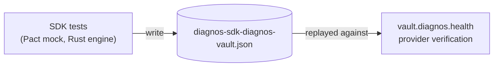

[](https://diagnos.health)

# integration

**Zero-knowledge SDK, CLI and REST API for the diagnos vault.**

**English** · [Português (Brasil)](README.pt-BR.md)

[](https://github.com/diagnos-tech/integration/actions/workflows/ci.yml?query=branch%3Amain)
[](https://github.com/diagnos-tech/integration/actions/workflows/ci.yml?query=branch%3Amain)
[](https://github.com/diagnos-tech/integration/actions/workflows/package.yml)
[](https://scorecard.dev/viewer/?uri=github.com/diagnos-tech/integration)
[](pyproject.toml)
[](LICENSE)

**[Install](docs/guides/install.md)** · **[SDK](apps/sdk/README.md)** · **[CLI](apps/cli/README.md)** ·
**[API](apps/api/README.md)** · [Wrappers](wrappers/README.md) · [Protocol](docs/PROTOCOL.md) ·
[Contract tests](contracts/README.md) · [Contributing](CONTRIBUTING.md) · [Security](SECURITY.md)

One open-source Python package, `diagnos`, for talking to the diagnos vault without ever handling a signed URL, an
HMAC or a key envelope yourself. Everything clinical is encrypted **inside your process** before it touches the network — the
vault only ever sees ciphertext. This package makes that the *easy* path.

> [!NOTE]
> **Status: 0.2.0 preview.** Every surface — the service account token, sessions, request signing, patients, exams,
> files and folders — speaks the vault's current protocol and is verified against it by the [contract tests](contracts/README.md).
> Known limits, and the questions still open on the vault side, are in [docs/COMPATIBILITY.md](docs/COMPATIBILITY.md).

## Install what you need

| Install | You get | Use it when |
|---|---|---|
| `pip install diagnos` | `diagnos docs`, `version`, `setup`, `help` — no dependencies | a first look; it installs the rest for you |
| `pip install "diagnos[sdk]"` | [the SDK](apps/sdk/README.md) — `from diagnos import Diagnos` | your code is Python |
| `pip install "diagnos[cli]"` | [the CLI](apps/cli/README.md) — `diagnos login`, `diagnos patients list`, … | scripts, operations, a quick look |
| `pip install "diagnos[api]"` | [the REST API](apps/api/README.md) — `diagnos-api`, or its signed image | your system speaks HTTP, not Python |

Same token, same session, same guarantees: the CLI and the API are thin shells over the SDK — they never
reimplement a single byte of cryptography. One package carries all three; an extra only adds a layer's
dependencies. Or let the base do it, step by step:

```sh
uv tool install diagnos   # or: pipx install diagnos
diagnos setup sdk         # the SDK in the Python project here, with uv
diagnos setup cli         # every command for this `diagnos`, with uv
diagnos setup api         # the API image, pulled and verified by digest, with Docker and cosign
```

Every release is signed with Sigstore and carries build provenance — [verify it](SECURITY.md#verifying-a-release).
Developers in other languages get the same four base commands through [wrappers](wrappers/README.md).

> [!NOTE]
> Until `0.2.0` is on PyPI, install from source — [Install](docs/guides/install.md) has the commands, and the
> [Rust toolchain](https://rustup.rs/) the build needs.

## Quick start — 60 seconds

**1. Get a token.** A workspace admin opens *Settings → Service accounts* in the diagnos web app, creates a service
account, picks the security groups it may read and copies its token — `dgn_sk1_…`, shown once, because the vault
keeps only its public keys.

**2. Keep it safe, once.**

```sh
diagnos login          # paste it: checked, proven against the vault, kept in the system keyring (or OpenBao)
```

In CI or a container, `export DIAGNOS_TOKEN="dgn_sk1_…"` from your secret store instead. Never in a file.

**3. Use it.** No approval step, no code to type: the token opens its session with one signed request.

```python
from diagnos import Diagnos

with Diagnos() as vault:  # finds the token, opens the session
    print(vault.workspace_id)
    print(vault.security_groups)  # the groups chosen for the token
```

```sh
diagnos whoami         # which token, from where, and its groups
diagnos patients list  # every command opens its own session, no prompt
diagnos logout         # forgets the stored token
```

> [!NOTE]
> The `apikey-` token in `DIAGNOS_API_TOKEN` is deprecated: it works, with a warning, until **2027-04-15**.
> [MIGRATING.md](MIGRATING.md#from-the-apikey--token-to-the-service-account-token-020) swaps it for a token.

**4. Go further.** Patients, exams and files hang off the same object — `vault.patients`, `vault.exams`,
`vault.drives`. The [quickstart](docs/guides/quickstart.md) goes from here to your first encrypted patient and file, and
[`examples/`](examples/README.md) has complete programs to copy: upload a file, patients, exams, error handling.

One name, three spellings: a **security group** is `security_group=` in the SDK (`security_group_id` on what it
returns), `--group` / `DIAGNOS_GROUP` in the CLI, and `security_group` or `{sg}` in the API.

The token's seed and every private key derived from it stay inside the SDK's Rust enclave, and nothing is written to
disk. [Authentication](docs/guides/authentication.md) shows the token and where it lives, and
[Sessions](docs/guides/sessions.md) how a session opens, expires and reopens on its own.

## Why two kinds of cryptography

Every request is signed twice — with **Ed25519**, the classic algorithm proven over many years, and with
**ML-DSA-65**, a post-quantum one (FIPS 204) — and the vault accepts it only when **both** signatures check out. The
keys the vault hands your process are sealed the same way, to **X25519** and **ML-KEM-768** (FIPS 203) together.

Why both? The classic algorithms are well understood, but a large enough quantum computer would break them. The
post-quantum ones resist that computer, but they are young. With both, an attacker has to break **both** — a flaw
found tomorrow in one of them, or a quantum computer some day, is not enough. Clinical data recorded today stays
protected tomorrow. You do not pick or configure any of it: the one token carries all four keys.

## What you get for free

- **🔐 End-to-end by default** — records and files are encrypted in your process; the vault sees ciphertext, signed
  requests and presigned URLs. [Exactly what it sees](docs/guides/security.md#what-the-vault-sees).
- **🛡️ Classic + post-quantum** — one token signs with Ed25519 *and* ML-DSA-65 and opens keys sealed to X25519 *and*
  ML-KEM-768; breaking one algorithm is not enough. [Why](#why-two-kinds-of-cryptography).
- **🧱 Keys in a Rust enclave** — `mlock`ed memory, guard pages, excluded from core dumps, zeroed on `fork()` and on
  drop, never handed back to Python as `bytes`. Threat model: [`apps/sdk/native/README.md`](apps/sdk/native/README.md).
- **🔁 Retries and clock skew handled** — idempotent retries, clock sync with the vault, stable exceptions:
  [Errors](docs/guides/errors.md).
- **📐 Pinned byte formats** — [`docs/PROTOCOL.md`](docs/PROTOCOL.md) is normative, and test vectors generated from
  the vault's reference implementation pin every byte.

## Servers

A server keeps the token in [OpenBao](https://openbao.org/), not in an environment file: `diagnos login --store
openbao` stores it once with a writer token, and the process reads it at startup with a token that may only read it —
then opens its session with no human, on every restart. Ready-made manifests live in
[`apps/api/deploy/`](apps/api/deploy/README.md): Docker Compose and Kubernetes, with OpenBao auto-unseal for AWS KMS,
Azure Key Vault, GCP KMS, Transit, Shamir and static keys.

## Documentation

| Start here | Then |
|---|---|
| [Quickstart](docs/guides/quickstart.md) · [Install](docs/guides/install.md) · [Concepts](docs/guides/concepts.md) | [Authentication](docs/guides/authentication.md) · [Sessions](docs/guides/sessions.md) · [Configuration](docs/guides/configuration.md) |
| [Patients](docs/guides/patients.md) · [Exams](docs/guides/exams.md) · [Files](docs/guides/files.md) · [Examples](examples/README.md) | [Errors](docs/guides/errors.md) · [Security model](docs/guides/security.md) |
| [CLI guide](docs/guides/cli.md) · [REST API guide](docs/guides/api.md) | [Deploying](apps/api/deploy/README.md) · [Protocol](docs/PROTOCOL.md) · [Compatibility](docs/COMPATIBILITY.md) |

The developer site publishes these same pages at `/dev/docs`, plus a reference generated from the code — every
command, route and class. [How the docs are built and checked](docs/README.md).

## Quality gates

Every badge above is a workflow or what one measures; all but the last two run locally with one command.

| Badge | What it proves | Locally |
|---|---|---|
| **CI** | every layer — base, SDK, CLI, API — passes its tests on CPython 3.11 and 3.13, plus the Rust enclave; lint (Python, Rust, bilingual docstrings, docs), `mypy --strict`, the lockfile, the docs (every example runs, the reference is fresh), the [Pact](https://pact.io) contract the vault verifies, and the workflows themselves (zizmor, actionlint) | `make check` |
| **Coverage** | combined branch coverage of the whole `diagnos` package, with a floor that only goes up | `make cov` |
| **Package** | all seven wheels and the sdist build, and each wheel works installed alone on its platform — bare, then with every extra; both images build | `uv build` |
| **OpenSSF Scorecard** | the supply-chain practices: pinned dependencies, least-privilege tokens, signed releases, branch protection | — |

Releases are cut from `main` by [`release.yml`](.github/workflows/release.yml): Sigstore signatures and SLSA
provenance on every file and image, an SBOM, PyPI through Trusted Publishing — no long-lived secret anywhere. CodeQL
analyzes every pull request, and libFuzzer exercises the enclave's parsers every week.

The contract is consumer-driven: the SDK's tests write
[`contracts/diagnos-sdk-diagnos-vault.json`](contracts/diagnos-sdk-diagnos-vault.json), and the vault verifies that
same file against its real code before it deploys.



## Repository layout

```
integration/
├── src/diagnos/       diagnos          the one package — `pip install diagnos[…]`
│   ├── _wrapper/      (base)           docs · version · setup · help, standard library only
│   ├── …              [sdk]            the SDK: client, crypto, session, transport, resources, models
│   ├── cli/           [cli]            `diagnos …` in your terminal
│   └── api/           [api]            REST facade (FastAPI), mTLS only
├── apps/              (per layer)      each layer's guide, tests and assets
│   ├── sdk/native/    diagnos._secure  Rust memory enclave
│   └── api/deploy/    compose · k8s    ready-to-run manifests
├── wrappers/          contract.json    the four base commands, for every language · py/: the Python one
├── examples/          NN-name/main.py  complete, runnable programs for the SDK
├── contracts/         Pact             consumer contract with the vault + its tests
├── docs/              guides/          the documentation · reference/ generated from the code
│                      PROTOCOL.md      normative byte formats · COMPATIBILITY.md · site.json
├── scripts/           docs/            the checks behind `make lint`, `make docs-check` and CI
└── Dockerfile         api · cli        the two images, built from the wheel
```

## Contributing

You need [uv](https://docs.astral.sh/uv/), Python 3.11–3.13 and, to build the enclave from source,
[rustup](https://rustup.rs/) — it installs the Rust that `rust-toolchain.toml` pins.

```sh
git clone https://github.com/diagnos-tech/integration && cd integration
make sync    # installs every extra, editable, and builds the Rust enclave
make check   # exactly what CI runs: lint, types, unit and contract tests, docs
make         # lists every other target
```

Read [CONTRIBUTING.md](CONTRIBUTING.md) before your first pull request. Coming from the `imgexam` packages? See
[MIGRATING.md](MIGRATING.md).

## Security

Found a vulnerability? Please **do not** open a public issue — report it privately through
[GitHub Security Advisories](https://github.com/diagnos-tech/integration/security/advisories/new). Details in
[SECURITY.md](SECURITY.md).

---

[Apache-2.0](LICENSE) · [diagnos.health](https://diagnos.health)
