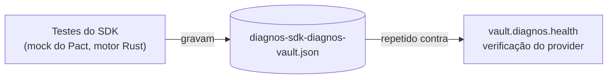

[](https://diagnos.health)

# integration

**SDK, CLI e API REST zero-knowledge para o cofre diagnos.**

[English](README.md) · **Português (Brasil)**

[](https://github.com/diagnos-tech/integration/actions/workflows/ci.yml?query=branch%3Amain)
[](https://github.com/diagnos-tech/integration/actions/workflows/ci.yml?query=branch%3Amain)
[](https://github.com/diagnos-tech/integration/actions/workflows/package.yml)
[](https://scorecard.dev/viewer/?uri=github.com/diagnos-tech/integration)
[](pyproject.toml)
[](LICENSE)

**[Instalação](docs/guides/install.pt-BR.md)** · **[SDK](apps/sdk/README.pt-BR.md)** · **[CLI](apps/cli/README.pt-BR.md)** ·
**[API](apps/api/README.pt-BR.md)** · [Wrappers](wrappers/README.pt-BR.md) · [Protocolo](docs/PROTOCOL.pt-BR.md) ·
[Testes de contrato](contracts/README.pt-BR.md) · [Como contribuir](CONTRIBUTING.pt-BR.md) · [Segurança](SECURITY.pt-BR.md)

Um pacote Python de código aberto, `diagnos`, para falar com o cofre diagnos sem nunca lidar com URL assinada, HMAC ou
envelope de chave. Tudo que é clínico é cifrado **dentro do seu processo** antes de tocar a rede — o cofre só vê
ciphertext. Este pacote faz disso o caminho *fácil*.

> [!NOTE]
> **Situação: prévia 0.2.0.** Toda superfície — enrollment, sessões, assinatura de requisições, pacientes, exames,
> arquivos e pastas — fala o protocolo atual do cofre e é verificada contra ele pelos
> [testes de contrato](contracts/README.pt-BR.md). Limites conhecidos, e as questões ainda em aberto do lado do cofre,
> estão em [docs/COMPATIBILITY.pt-BR.md](docs/COMPATIBILITY.pt-BR.md).

## Instale o que você precisa

| Instale | Você ganha | Use quando |
|---|---|---|
| `pip install diagnos` | `diagnos docs`, `version`, `setup`, `help` — sem dependências | uma primeira olhada; ela instala o resto para você |
| `pip install "diagnos[sdk]"` | [o SDK](apps/sdk/README.pt-BR.md) — `from diagnos import Diagnos` | seu código é Python |
| `pip install "diagnos[cli]"` | [a CLI](apps/cli/README.pt-BR.md) — `diagnos login`, `diagnos patients list`, … | scripts, operação, uma olhada rápida |
| `pip install "diagnos[api]"` | [a API REST](apps/api/README.pt-BR.md) — `diagnos-api`, ou a imagem assinada dela | seu sistema fala HTTP, não Python |

Mesma credencial, mesmo fluxo de aprovação, mesmas garantias: a CLI e a API são cascas finas sobre o SDK — nunca
reimplementam um único byte de criptografia. Um pacote traz os três; um extra só soma as dependências de uma camada.
Ou deixe a base fazer, passo a passo:

```sh
uv tool install diagnos   # ou: pipx install diagnos
diagnos setup sdk         # o SDK no projeto Python daqui, com uv
diagnos setup cli         # todos os comandos para este `diagnos`, com uv
diagnos setup api         # a imagem da API, baixada e verificada pelo digest, com Docker e cosign
```

Todo release é assinado com Sigstore e traz proveniência de build — [verifique](SECURITY.pt-BR.md#verificando-um-release).
Quem programa em outras linguagens ganha os mesmos quatro comandos da base pelos [wrappers](wrappers/README.pt-BR.md).

> [!NOTE]
> Até a `0.2.0` estar no PyPI, instale do código-fonte — [Instalação](docs/guides/install.pt-BR.md) tem os comandos,
> e o [toolchain Rust](https://rustup.rs/) que o build precisa.

## Começando

**1. Consiga uma credencial.** Um admin do workspace abre *Configurações → Contas de serviço* no app web do
diagnos, cria uma conta de serviço e copia a credencial dela — mostrada uma vez, porque o cofre guarda só a metade
pública da chave:

```sh
export DIAGNOS_CREDENTIAL="svc_<32 hex>@<workspace_id>.diagnos.health:<chave>"
```

> [!NOTE]
> O token `apikey-` em `DIAGNOS_API_TOKEN` está obsoleto: funciona, com aviso, até **2027-04-15**.
> O [MIGRATING.pt-BR.md](MIGRATING.pt-BR.md#do-token-apikey--para-uma-credencial-de-conta-de-serviço-020) troca em três passos.

**2. Faça o enrollment.** A primeira execução imprime um link e um código de 6 dígitos; um admin aprova no app web e
escolhe quais security groups este processo pode ler.

```python
from diagnos import Diagnos

with Diagnos() as vault:  # faz enrollment na entrada: imprime o link de aprovação + código
    print(vault.workspace_id)
    print(vault.security_groups)  # os grupos que o admin concedeu
```

```sh
diagnos login          # o mesmo enrollment, pelo terminal — guardado para os próximos comandos
diagnos patients list  # reaproveita, sem nova aprovação
diagnos logout         # revoga e apaga as chaves
```

**3. Use.** Pacientes, exames e arquivos pendem do mesmo objeto — `vault.patients`, `vault.exams`, `vault.drives`. O
[início rápido](docs/guides/quickstart.pt-BR.md) vai daqui até o primeiro paciente e o primeiro arquivo cifrados, e
[`examples/`](examples/README.pt-BR.md) tem programas completos para copiar: subir um arquivo, pacientes, exames,
tratamento de erros.

Um nome, três grafias: um **security group** é `security_group=` no SDK (`security_group_id` no que ele devolve),
`--group` / `DIAGNOS_GROUP` na CLI, e `security_group` ou `{sg}` na API.

As chaves privadas nunca saem do processo e nada é gravado em disco, então um processo novo precisa de uma nova
aprovação — isso é o desenho, não uma limitação. A CLI mantém a sessão num único processo em segundo plano entre o
`login` e o `logout`. [Autenticação](docs/guides/authentication.pt-BR.md) mostra a credencial e o enrollment inteiro, e
[Sessões](docs/guides/sessions.pt-BR.md#auto-unseal-com-openbao) como servidores reiniciam sem humano.

## O que vem de graça

- **🔐 Ponta a ponta por padrão** — registros e arquivos são cifrados no seu processo; o cofre vê ciphertext,
  requisições assinadas e URLs pré-assinadas. [Exatamente o que ele vê](docs/guides/security.pt-BR.md#o-que-o-cofre-vê).
- **🛡️ Híbrido pós-quântico** — o enrollment usa X25519 + ML-KEM-768, então uma sessão gravada continua segura contra
  um adversário quântico futuro.
- **🧱 Chaves num enclave Rust** — memória travada com `mlock`, guard pages, fora de core dumps, zerada no `fork()` e
  ao descartar, nunca devolvida ao Python como `bytes`. Modelo de ameaça:
  [`apps/sdk/native/README.pt-BR.md`](apps/sdk/native/README.pt-BR.md).
- **🔁 Retentativa e relógio resolvidos** — retentativas idempotentes, sincronia de relógio com o cofre, exceções
  estáveis: [Erros](docs/guides/errors.pt-BR.md).
- **📐 Formatos de bytes travados** — [`docs/PROTOCOL.pt-BR.md`](docs/PROTOCOL.pt-BR.md) é normativo, e vetores de
  teste gerados da implementação de referência do cofre travam cada byte.

## Servidores sem humano

Uma aprovação humana a cada reinício serve num notebook; não serve num pod Kubernetes. Aponte o SDK para o
[OpenBao](https://openbao.org/) e ele salva a sessão desbloqueada logo após o enrollment e a restaura a cada subida —
uma troca deliberada, [explicada por inteiro](docs/guides/sessions.pt-BR.md#auto-unseal-com-openbao) antes de você
ligar. Manifestos prontos ficam em [`apps/api/deploy/`](apps/api/deploy/README.pt-BR.md): Docker Compose e Kubernetes,
com auto-unseal do OpenBao para AWS KMS, Azure Key Vault, GCP KMS, Transit, Shamir e chave estática.

## Documentação

| Comece aqui | Depois |
|---|---|
| [Início rápido](docs/guides/quickstart.pt-BR.md) · [Instalação](docs/guides/install.pt-BR.md) · [Conceitos](docs/guides/concepts.pt-BR.md) | [Autenticação](docs/guides/authentication.pt-BR.md) · [Sessões](docs/guides/sessions.pt-BR.md) · [Configuração](docs/guides/configuration.pt-BR.md) |
| [Pacientes](docs/guides/patients.pt-BR.md) · [Exames](docs/guides/exams.pt-BR.md) · [Arquivos](docs/guides/files.pt-BR.md) · [Exemplos](examples/README.pt-BR.md) | [Erros](docs/guides/errors.pt-BR.md) · [Modelo de segurança](docs/guides/security.pt-BR.md) |
| [Guia da CLI](docs/guides/cli.pt-BR.md) · [Guia da API REST](docs/guides/api.pt-BR.md) | [Implantação](apps/api/deploy/README.pt-BR.md) · [Protocolo](docs/PROTOCOL.pt-BR.md) · [Compatibilidade](docs/COMPATIBILITY.pt-BR.md) |

O site de desenvolvedores publica estas mesmas páginas em `/dev/docs`, mais uma referência gerada a partir do código —
todo comando, rota e classe. [Como a doc é construída e checada](docs/README.pt-BR.md).

## Portões de qualidade

Todo badge acima é um workflow ou o que um deles mede; todos menos os dois últimos rodam localmente com um comando.

| Badge | O que prova | Localmente |
|---|---|---|
| **CI** | toda camada — base, SDK, CLI, API — passa nos testes no CPython 3.11 e 3.13, mais o enclave Rust; lint (Python, Rust, docstrings bilíngues, documentação), `mypy --strict`, o lockfile, a doc (todo exemplo roda, a referência está em dia), o contrato [Pact](https://pact.io) que o cofre verifica, e os próprios workflows (zizmor, actionlint) | `make check` |
| **Cobertura** | cobertura de ramos combinada do pacote `diagnos` inteiro, com um piso que só sobe | `make cov` |
| **Pacote** | os sete wheels e o sdist constroem, e cada wheel funciona instalado sozinho na própria plataforma — puro, depois com todo extra; as duas imagens constroem | `uv build` |
| **OpenSSF Scorecard** | as práticas de cadeia de suprimentos: dependências fixadas, tokens com privilégio mínimo, releases assinados, proteção de branch | — |

Os releases saem da `main` pelo [`release.yml`](.github/workflows/release.yml): assinaturas Sigstore e proveniência
SLSA em todo arquivo e imagem, um SBOM, PyPI via Trusted Publishing — nenhum segredo de longa duração em lugar nenhum.
O CodeQL analisa todo pull request, e o libFuzzer exercita os parsers do enclave toda semana.

O contrato é guiado pelo consumidor: os testes do SDK gravam
[`contracts/diagnos-sdk-diagnos-vault.json`](contracts/diagnos-sdk-diagnos-vault.json), e o cofre verifica esse
mesmo arquivo contra o código real dele antes de implantar.



## Estrutura

```
integration/
├── src/diagnos/       diagnos          o pacote único — `pip install diagnos[…]`
│   ├── _wrapper/      (base)           docs · version · setup · help, só biblioteca padrão
│   ├── …              [sdk]            o SDK: client, crypto, session, transport, resources, models
│   ├── cli/           [cli]            `diagnos …` no seu terminal
│   └── api/           [api]            fachada REST (FastAPI), só mTLS
├── apps/              (por camada)     o guia, os testes e os recursos de cada camada
│   ├── sdk/native/    diagnos._secure  enclave de memória em Rust
│   └── api/deploy/    compose · k8s    manifestos prontos para rodar
├── wrappers/          contract.json    os quatro comandos da base, para toda linguagem · py/: o de Python
├── examples/          NN-nome/main.py  programas completos e executáveis para o SDK
├── contracts/         Pact             contrato do consumidor com o cofre + os testes dele
├── docs/              guides/          a documentação · reference/ gerada a partir do código
│                      PROTOCOL.md      formatos de bytes normativos · COMPATIBILITY.md · site.json
├── scripts/           docs/            as checagens por trás do `make lint`, do `make docs-check` e da CI
└── Dockerfile         api · cli        as duas imagens, construídas a partir do wheel
```

## Como contribuir

Você precisa de [uv](https://docs.astral.sh/uv/), Python 3.11–3.13 e, para construir o enclave do fonte,
[rustup](https://rustup.rs/) — ele instala o Rust que o `rust-toolchain.toml` fixa.

```sh
git clone https://github.com/diagnos-tech/integration && cd integration
make sync    # instala todo extra, editável, e constrói o enclave Rust
make check   # exatamente o que a CI roda: lint, tipos, testes unitários e de contrato, doc
make         # lista todos os outros alvos
```

Leia o [CONTRIBUTING.pt-BR.md](CONTRIBUTING.pt-BR.md) antes do primeiro pull request. Vindo dos pacotes `imgexam`?
Veja o [MIGRATING.pt-BR.md](MIGRATING.pt-BR.md).

## Segurança

Achou uma vulnerabilidade? Por favor **não** abra issue pública — reporte em privado pelo
[GitHub Security Advisories](https://github.com/diagnos-tech/integration/security/advisories/new). Detalhes no
[SECURITY.pt-BR.md](SECURITY.pt-BR.md).

---

[Apache-2.0](LICENSE) · [diagnos.health](https://diagnos.health)
