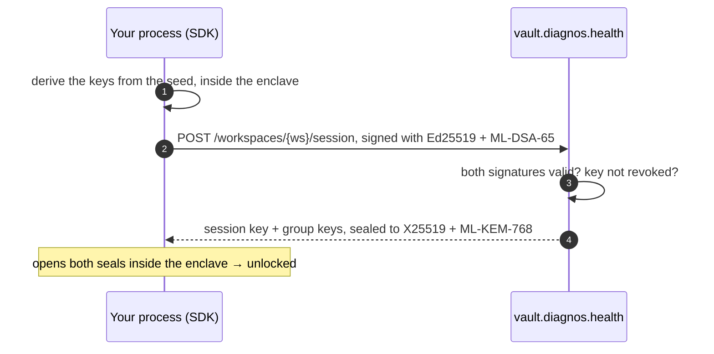

# Authentication

**English** · [Português (Brasil)](authentication.pt-BR.md)

A diagnos process needs one thing before it can read a single record: a **service account token**. The token is both
the identity — which service account, which workspace — and the key that opens the vault's keys for the groups the
token was given. There is no pairing step and no approval code: a process that has the token signs one request, and
the session is open.

## The service account token

A workspace admin creates a service account in the diagnos web app (*Settings → Service accounts*), choosing its
permissions and the security groups it may read. The token is born in the admin's browser, which is already unlocked:
it draws 32 random bytes (the *seed*), derives the token's public keys from them, and seals the keys of the chosen
groups to those public keys. The vault receives only the public keys and the sealed group keys — never the seed. The
token is shown **once**, as one line of about 100 characters:

```text
dgn_sk1_<key id, seed, workspace and a checksum, in base64url>
```

The `dgn_sk1_` prefix makes it recognizable to secret scanners (gitleaks, GitHub secret scanning) and to the CLI. The
last four bytes are a CRC-32: a token cut short or pasted wrong is caught **before any network call**, with a message
that says exactly that. The SDK moves the seed into its Rust enclave the moment it parses the line; everything the
token does is derived from the seed there, and neither the seed nor any private key ever leaves it.

| Exposed as | Meaning |
|---|---|
| `vault.workspace_id` | the workspace every URL is built for |
| `vault.identity` | `svc_<hex>@<workspace_id>.diagnos.health` |
| `vault.key_id` | `svc_<hex>` — the key an admin rotates or revokes |
| `vault.token_kind` | `"hybrid"` (`"legacy_apikey"` for the deprecated token) |
| `vault.token_source` | where the token was read from — `DIAGNOS_TOKEN`, `keyring`, `OpenBao …` |
| `vault.account_id`, `vault.name`, `vault.email` | `None`: the identity is the key itself |

```python
from diagnos import Diagnos

vault = Diagnos()  # finds the token and checks its CRC; nothing touches the network yet
print(vault.workspace_id, vault.key_id, vault.token_kind, vault.token_source)
print(repr(vault))  # the identity only — the token is never shown
```

> [!WARNING]
> Whoever holds the token has the access it gives, like a private key: it opens the groups it was given, with no one
> to approve. That is why it is shown once, why the CLI keeps it in the system keyring or in OpenBao and never in a
> text file, why a revocation takes effect on the next request, and why its scope should be the smallest that works.
> The SDK never logs it: `repr` and `str` show only the identity, a token refuses to be pickled, and an error never
> carries its text.

## Why two signatures — classic and post-quantum

Every request is signed twice, and the vault accepts it only when **both** signatures are valid: once with Ed25519, the
classic algorithm in use for years, and once with ML-DSA-65 (FIPS 204), a post-quantum algorithm. The keys of the
vault are sealed the same way, to X25519 and ML-KEM-768 (FIPS 203) together, and a seal opens only with both secrets.

The reason is simple: the classic algorithms are well tested but a large enough quantum computer would break them; the
post-quantum ones resist that computer but are young. Using both means an attacker has to break **both** — a flaw found
in one of them, or a quantum computer in the future, is not enough. Data recorded today stays protected tomorrow. The
cost is a larger signature (3,373 bytes per request), which you never handle yourself.

The signature follows [HTTP Message Signatures, RFC 9421](https://www.rfc-editor.org/rfc/rfc9421): there is no bearer
secret to steal off the wire, and each request carries a fresh timestamp and nonce, so a copied request is refused.

## Where the token lives

The SDK looks in this order, and the first one found wins:

| Where | When |
|---|---|
| `Diagnos(token=…)` / `--token` | one process that talks as two service accounts |
| `DIAGNOS_TOKEN` in the environment | CI and ephemeral containers, where a secret arrives as a variable |
| the system keyring | a workstation: `diagnos login` keeps it there — macOS Keychain, Windows Credential Locker, Secret Service or KWallet |
| OpenBao, `secret/diagnos/token` | a server: `diagnos login --store openbao` keeps it there, and `diagnos-api` reads it at startup |

**Recommended:** the keyring on a workstation and OpenBao on a server. `diagnos login` picks the first safe one: the
system keyring when there is one that encrypts at rest (a plain-text or "null" keyring backend does not count), else
OpenBao when `OPENBAO_ADDR` is configured, else it refuses and explains both options. It **never** writes the token to a
text file. `DIAGNOS_TOKEN` stays for CI and short-lived containers; when the CLI notices the token came from the
environment in an interactive terminal, it says so once.

The same is available from Python, for an installer or a provisioning script:

```python no-run
from diagnos import Settings, forget_token, save_token

where = save_token(token_text, settings=Settings.without_token())  # "keyring (…)" or "OpenBao …"
removed = forget_token(settings=Settings.without_token())  # where it was removed from
```

`Diagnos(settings=Settings(token=…))` takes it with no environment at all — see [Configuration](configuration.md).

## Opening a session



1. The SDK derives the token's four key pairs from the seed (HKDF-SHA-256): Ed25519 and ML-DSA-65 to sign, X25519 and
   ML-KEM-768 to open seals.
2. It sends one signed `POST …/session`, with no body. The vault checks both signatures and that the key is still
   valid.
3. The answer carries the session key and the keys of the token's groups, each sealed to the token's public keys. The
   enclave opens them; nothing is written to disk.

You rarely do this yourself: the first touch of `vault.patients`, `vault.exams` or `vault.drives` opens the session,
and `with Diagnos() as vault:` opens it on entry. If the vault drops the session (a restart, an expiry), the SDK opens
a new one and retries the call once — no human, no prompt. `whoami()` opens a session and reports what it was given:

```python
with Diagnos() as vault:
    me = vault.whoami()
    print(me.identity, me.security_groups, me.session_expires_at)
```

## Which groups a process gets

The admin decides when creating the token: only the groups chosen then are sealed to it, and `vault.security_groups`
lists them once the session is open. Touching data of any other group raises `GroupKeyUnavailable` — a permission gap,
not a crypto failure — and list rows of such groups come back with `summary=None` instead of failing the page:

```python
from diagnos import Diagnos, GroupKeyUnavailable

with Diagnos() as vault:
    print("granted:", vault.security_groups)
    try:
        vault.patients.create({"legal_name": "Jane Doe", "display_name": "Jane"}, security_group="sg_cardiology")
    except GroupKeyUnavailable as error:
        print("not granted:", error)
```

The fix is a new token that includes the group: widening a scope is creating a token.

## Rotating and revoking

- **Rotate** by creating a new key on the same service account, with fresh seals: both are valid until the old one is
  revoked, so there is no window without access. Store the new token (`diagnos login` again, or update the secret),
  restart, then revoke the old key.
- **Revoke** in the web app. The next signed request with that key fails with `CredentialRevokedError`, and a session
  it opened drops on its next use (see [Errors](errors.md#credential-failures)). The seals of a revoked key are deleted.

## The legacy `apikey-` token

> [!IMPORTANT]
> `DIAGNOS_API_TOKEN` (an `apikey-` followed by a JWT) is **deprecated and stops working on 2027-04-15**. Until then
> the SDK still accepts it, emits a `LegacyTokenWarning` pointing at your own line and logs one warning per process.
> [MIGRATING.md](../../MIGRATING.md#from-the-apikey--token-to-the-service-account-token-020) swaps it for a token.

The legacy token has no key of its own: the SDK reads four claims from it without verifying the signature and sends it
as a bearer on every request. With it `vault.account_id`, `vault.name` and `vault.key_id` come from those claims,
`vault.identity` is `None` and `vault.token_kind` is `"legacy_apikey"`. It can be handed over as `DIAGNOS_API_TOKEN`,
`Diagnos(token="apikey-…")` or `Settings(api_token=…)`. Anything set in the environment beats any store, so what a shell
exports is always what runs.

It also keeps the old way to get keys, the **enrollment**: the process generates an X25519 + ML-KEM-768 key pair in
RAM, registers the public half, and shows a link and a 6-digit code; a workspace admin opens the link, checks the
machine asking, types the code and picks the groups. `unlock()` waits for the answer and raises
`EnrollmentDeniedError` or `EnrollmentExpiredError` when there is none. The link and the code go to `stderr`, or to your
`on_prompt` callback:

```python no-run
from diagnos import Diagnos, EnrollmentPrompt


def notify(prompt: EnrollmentPrompt) -> None:
    # EnrollmentPrompt: enrollment_id, approval_url, code, expires_at (Unix seconds)
    print(f"Approve {prompt.approval_url} with code {prompt.code} before {prompt.expires_at}")


vault = Diagnos(on_prompt=notify)  # with DIAGNOS_API_TOKEN set
vault.unlock()
```

In the CLI, `diagnos session start` runs that enrollment once and keeps the session in a background agent, so the next
commands do not ask again — see the [CLI guide](cli.md#the-legacy-token-in-the-terminal).

## Good practice

- **One service account per integration**, and one per replica if it runs as several processes: an admin can then
  revoke exactly one of them.
- **The fewest groups that work.** A token can decrypt everything in the groups it holds.
- **The keyring on a workstation, OpenBao on a server**, `DIAGNOS_TOKEN` only for CI and ephemeral containers, straight
  from a secret store. Never in a repository, a `.env` file or a log line.
- **Rotate with overlap.** Create the new key, deploy it, then revoke the old one.
