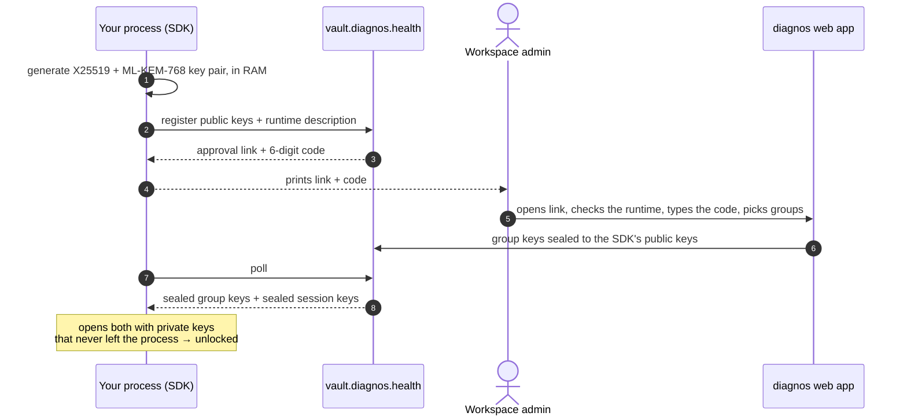

# Authentication

**English** · [Português (Brasil)](authentication.pt-BR.md)

A diagnos process needs two things before it can read a single record: a **credential** that says which service
account it is, and an **enrollment** that a person approved, which says what this particular process may decrypt.
Neither is enough alone — a leaked credential cannot decrypt anything without a human approving the process that
holds it.

## The service account credential

A workspace admin creates a service account in the diagnos web app (*Settings → Service accounts*). The key pair is
born in the admin's browser: the vault keeps only the public key, so nobody — the vault included — can act as the
service account without what the admin saved. The private half is shown **once**, as one line:

```text
svc_<32 hex>@<workspace_id>.diagnos.health:<43-character key>
```

Before the last `:` is the *identity*, which reads like an e-mail address and names one key of one service account in
one workspace. After it is the private key, a 32-byte Ed25519 seed. The SDK moves the seed into its Rust enclave the
moment it parses the line and signs every request with it ([HTTP Message Signatures, RFC 9421](https://www.rfc-editor.org/rfc/rfc9421)):
there is no bearer secret to steal off the wire, and each request carries a fresh signature and nonce, so a copied
request is refused.

| Exposed as | Meaning |
|---|---|
| `vault.workspace_id` | the workspace every URL is built for |
| `vault.identity` | `svc_<hex>@<workspace_id>.diagnos.health` |
| `vault.key_id` | `svc_<hex>` — the key an admin rotates or revokes |
| `vault.name`, `vault.email` | the account's short name and address; `None` when only the one-line form is known (the downloaded file carries the name) |
| `vault.account_id` | `None`: the identity is the key itself |
| `vault.credential_kind` | `"ed25519"` |

```python
from diagnos import Diagnos

vault = Diagnos()  # parses DIAGNOS_CREDENTIAL; nothing touches the network yet
print(vault.workspace_id, vault.key_id, vault.credential_kind)
print(repr(vault))  # the identity is masked, the key is never shown
```

The SDK looks for the credential in this order, and the first one found wins:

| Where | When |
|---|---|
| `Diagnos(credential=…)` | one process that talks as two service accounts: the line, the path of the JSON file, or a `ServiceAccountCredential` |
| `DIAGNOS_CREDENTIAL` in the environment | the usual case: a secret store straight into the variable |
| `DIAGNOS_CREDENTIALS_FILE` | the path of the JSON file downloaded at creation — a Kubernetes or Compose secret mounted `0400` |
| `~/.config/diagnos/credentials.json` | that same file on a workstation, `chmod 600`; no variable needed |

`Diagnos(settings=Settings(credential=…))` takes it with no environment at all — see [Configuration](configuration.md).
A key can carry an expiry, and an admin can rotate it by creating a second key next to the first, switching the
process over and revoking the old one — revocation is server-side, and the next signed call fails with
`CredentialRevokedError` (see [Errors](errors.md#credential-failures)).

> [!WARNING]
> The key is a secret: anyone who holds it can *ask* for an enrollment as this service account. Keep it in a secret
> store or a mounted file, never in a repository or a log line. The SDK never prints it — `repr` and `str` show only
> a masked identity, and a credential refuses to be pickled.

### The legacy `apikey-` token

> [!IMPORTANT]
> `DIAGNOS_API_TOKEN` (an `apikey-` followed by a JWT) is **deprecated and stops working on 2027-04-15**. Until then
> the SDK still accepts it when no credential is configured, emits a `LegacyTokenWarning` pointing at your own line and
> logs one warning per process. [MIGRATING.md](../../MIGRATING.md#from-the-apikey--token-to-a-service-account-credential-020)
> swaps it for a credential in three steps.

The token has no key of its own to sign with: the SDK reads four claims from it without verifying the signature, and
sends it as a bearer on every request. With it `vault.account_id`, `vault.name` and `vault.key_id` come from those
claims, `vault.identity` is `None` and `vault.credential_kind` is `"legacy_apikey"`. It can be handed over as
`DIAGNOS_API_TOKEN`, `Diagnos(token="apikey-…")` or `Settings(api_token=…)`, and the CLI takes `--token` for one
invocation. An explicit `token=` hides the credential variables, so the argument you typed always wins.

## Enrollment



1. The process generates a hybrid key pair — X25519 plus ML-KEM-768, so a recorded enrollment stays safe against a
   future quantum adversary — and registers the public half with the vault.
2. It shows a link and a 6-digit code. An admin opens the link in the web app, checks the description of the machine
   asking, types the code and picks the security groups this process may read.
3. The web app seals the keys of those groups **to the process's public keys**; the vault seals the session keys the
   same way. The process opens both with private keys that never left its memory.

Nothing is written to disk. The approval is the security model, not friction to route around: there is no API to
approve an enrollment programmatically.

### What the approver sees

Next to the code, the approval page shows the `runtime` the process described itself with, so a person can notice
"I don't recognize this machine" before approving:

| Field | Example |
|---|---|
| `sdk_name`, `sdk_version` | `diagnos-python`, `0.1.0` |
| `language`, `os`, `arch` | `python 3.12`, `linux`, `x86_64` |
| `hostname`, `user` | `billing-worker-7f9c`, `app` (when they can be read) |
| `container`, `cloud` | `true`, `aws` (detected, best effort) |

> [!IMPORTANT]
> Approve only an enrollment you started and whose runtime you recognize. An approval is what turns a credential into the
> ability to decrypt a group's data.

### Waiting for the approval

`unlock()` blocks until the admin answers, polling at the interval the vault sets. Three endings are possible:

| Outcome | What happens |
|---|---|
| approved | `unlock()` returns; the process is unlocked |
| denied | `EnrollmentDeniedError` |
| nobody answered before `expires_at` | `EnrollmentExpiredError` — run it again for a new link and code |

```python
from diagnos import Diagnos, EnrollmentDeniedError, EnrollmentExpiredError

try:
    vault = Diagnos()
    vault.unlock()
except EnrollmentDeniedError:
    raise SystemExit("an admin denied this process") from None
except EnrollmentExpiredError:
    raise SystemExit("nobody approved in time; run again for a new code") from None
```

You rarely call `unlock()` yourself: the first touch of `vault.patients`, `vault.exams` or `vault.drives` unlocks
lazily, and `with Diagnos() as vault:` unlocks on entry. It is idempotent either way.

### Showing the prompt yourself

By default the link and the code go to `stderr`, as plain text that reads the same in a terminal and in a CI log:

```text
diagnos SDK — enrollment approval needed · aprovação de enrollment necessária

Open this link to approve · Abra este link para aprovar:
  https://…

Code to type · Código para digitar:
  4 8 2 9 1 5

Expires at (unix seconds) · Expira em (segundos unix): 1790000000
```

To send them somewhere else — a chat channel, a pager, your own UI — pass `on_prompt`. It is called once, before the
wait starts, with an `EnrollmentPrompt`:

```python
from diagnos import Diagnos, EnrollmentPrompt


def notify(prompt: EnrollmentPrompt) -> None:
    # EnrollmentPrompt: enrollment_id, approval_url, code, expires_at (Unix seconds)
    print(f"Approve {prompt.approval_url} with code {prompt.code} before {prompt.expires_at}")


vault = Diagnos(on_prompt=notify)
vault.unlock()
```

### Where the prompt appears

| Package | Where the link and code go |
|---|---|
| SDK | `stderr`, or your `on_prompt` |
| CLI | a panel on `stderr`, then a spinner until approved — see the [CLI guide](cli.md#enrollment-in-the-terminal) |
| REST API | the process's `stderr`, i.e. the container log; startup waits until approved — see the [API guide](api.md#startup-and-the-enrollment-prompt) |

## Which groups a process gets

The admin decides at approval time; `vault.security_groups` lists what was granted. Touching data of any other group
raises `GroupKeyUnavailable` — a permission gap, not a crypto failure — and list rows of such groups come back with
`summary=None` instead of failing the page:

```python
from diagnos import Diagnos, GroupKeyUnavailable

with Diagnos() as vault:
    print("granted:", vault.security_groups)
    try:
        vault.patients.create({"legal_name": "Jane Doe", "display_name": "Jane"}, security_group="sg_cardiology")
    except GroupKeyUnavailable as error:
        print("not granted:", error)
```

The fix is a new enrollment that includes the group: restart the process (or clear its saved session, if it uses
[OpenBao](sessions.md#auto-unseal-with-openbao)) and ask the admin to pick it.

## Good practice

- **One service account per integration**, and one per replica if it runs as several processes: an admin can then
  revoke exactly one of them.
- **The fewest groups that work.** An enrollment can decrypt everything in the groups it holds.
- **The credential comes from a secret store** — a Kubernetes Secret, your CI's secret variables — straight into
  `DIAGNOS_CREDENTIAL` (or a mounted `DIAGNOS_CREDENTIALS_FILE`), never from a file in the repository. `diagnos`
  itself never logs it.
- **Rotate with overlap.** Create the new key, deploy it, then revoke the old one; a service account can hold up to five
  keys at once, so there is no window without access.
- **Servers restart without a human** only through OpenBao auto-unseal — a deliberate trade described in
  [Sessions](sessions.md).
