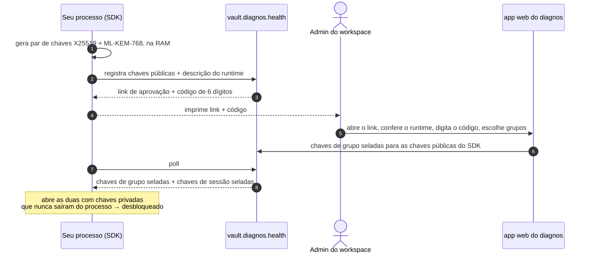

# Autenticação

[English](authentication.md) · **Português (Brasil)**

Um processo diagnos precisa de duas coisas antes de ler um único registro: uma **credencial** que diz qual service
account ele é, e um **enrollment** que uma pessoa aprovou, que diz o que este processo em particular pode decifrar.
Nenhum dos dois basta sozinho — uma credencial vazada não decifra nada sem uma pessoa aprovar o processo que a segura.

## A credencial da service account

Um admin do workspace cria uma service account no app web do diagnos (*Configurações → Contas de serviço*). O par de
chaves nasce no navegador do admin: o cofre guarda só a chave pública, então ninguém — o cofre inclusive — age como a
service account sem o que o admin guardou. A metade privada aparece **uma vez**, numa linha só:

```text
svc_<32 hex>@<workspace_id>.diagnos.health:<chave de 43 caracteres>
```

Antes do último `:` está a *identidade*, que se lê como um e-mail e nomeia uma chave de uma service account de um
workspace. Depois dele está a chave privada, uma semente Ed25519 de 32 bytes. O SDK move a semente para o enclave Rust
no instante em que lê a linha e assina toda requisição com ela ([HTTP Message Signatures, RFC 9421](https://www.rfc-editor.org/rfc/rfc9421)):
não há segredo bearer para roubar do fio, e cada requisição leva assinatura e nonce novos, então uma cópia é recusada.

| Exposta como | Significado |
|---|---|
| `vault.workspace_id` | o workspace para o qual toda URL é montada |
| `vault.identity` | `svc_<hex>@<workspace_id>.diagnos.health` |
| `vault.key_id` | `svc_<hex>` — a chave que um admin gira ou revoga |
| `vault.name`, `vault.email` | o nome curto e o endereço da conta; `None` quando só a forma de uma linha é conhecida (o arquivo baixado traz o nome) |
| `vault.account_id` | `None`: a identidade é a própria chave |
| `vault.credential_kind` | `"ed25519"` |

```python
from diagnos import Diagnos

vault = Diagnos()  # lê DIAGNOS_CREDENTIAL; nada toca a rede ainda
print(vault.workspace_id, vault.key_id, vault.credential_kind)
print(repr(vault))  # a identidade é mascarada, a chave nunca aparece
```

O SDK procura a credencial nesta ordem, e vale a primeira que achar:

| Onde | Quando |
|---|---|
| `Diagnos(credential=…)` | um processo que fala como duas service accounts: a linha, o caminho do JSON ou uma `ServiceAccountCredential` |
| `DIAGNOS_CREDENTIAL` no ambiente | o caso comum: um cofre de segredos direto para a variável |
| `DIAGNOS_CREDENTIALS_FILE` | o caminho do JSON baixado na criação — um secret do Kubernetes ou do Compose montado `0400` |
| `~/.config/diagnos/credentials.json` | esse mesmo arquivo numa estação de trabalho, `chmod 600`; sem variável |

`Diagnos(settings=Settings(credential=…))` a recebe sem ambiente nenhum — veja [Configuração](configuration.pt-BR.md).
Uma chave pode ter validade, e um admin a gira criando uma segunda chave ao lado da primeira, trocando o processo e
revogando a antiga — a revogação é do lado do servidor, e a chamada assinada seguinte falha com
`CredentialRevokedError` (veja [Erros](errors.pt-BR.md#falhas-de-credencial)).

> [!WARNING]
> A chave é um segredo: quem a tem consegue *pedir* um enrollment como esta service account. Guarde-a num cofre de
> segredos ou num arquivo montado, nunca num repositório ou numa linha de log. O SDK nunca a imprime — `repr` e `str`
> mostram só uma identidade mascarada, e uma credencial se recusa a ser serializada com pickle.

### O token legado `apikey-`

> [!IMPORTANT]
> `DIAGNOS_API_TOKEN` (um `apikey-` seguido de um JWT) está **obsoleto e deixa de funcionar em 2027-04-15**. Até lá
> o SDK ainda o aceita quando nenhuma credencial está configurada, emite um `LegacyTokenWarning` apontando para a sua
> própria linha e registra um aviso por processo. O [MIGRATING.pt-BR.md](../../MIGRATING.pt-BR.md#do-token-apikey--para-uma-credencial-de-conta-de-serviço-020)
> troca por uma credencial em três passos.

O token não tem chave própria para assinar: o SDK lê quatro claims dele sem conferir a assinatura, e o envia como
bearer em toda requisição. Com ele, `vault.account_id`, `vault.name` e `vault.key_id` vêm dessas claims,
`vault.identity` é `None` e `vault.credential_kind` é `"legacy_apikey"`. Ele pode ser entregue como
`DIAGNOS_API_TOKEN`, `Diagnos(token="apikey-…")` ou `Settings(api_token=…)`, e a CLI aceita `--token` para uma única
invocação. Um `token=` explícito esconde as variáveis de credencial, então o argumento que você digitou sempre vence.

## Enrollment



1. O processo gera um par de chaves híbrido — X25519 mais ML-KEM-768, para um enrollment gravado continuar seguro
   contra um adversário quântico no futuro — e registra a metade pública no cofre.
2. Ele mostra um link e um código de 6 dígitos. Um admin abre o link no app web, confere a descrição da máquina que
   está pedindo, digita o código e escolhe os security groups que este processo pode ler.
3. O app web sela as chaves desses grupos **para as chaves públicas do processo**; o cofre sela as chaves de sessão do
   mesmo jeito. O processo abre as duas com chaves privadas que nunca saíram da memória dele.

Nada é gravado em disco. A aprovação é o modelo de segurança, não atrito a contornar: não existe API para aprovar um
enrollment por programa.

### O que quem aprova vê

Ao lado do código, a página de aprovação mostra o `runtime` com que o processo se descreveu, para uma pessoa perceber
"não reconheço esta máquina" antes de aprovar:

| Campo | Exemplo |
|---|---|
| `sdk_name`, `sdk_version` | `diagnos-python`, `0.1.0` |
| `language`, `os`, `arch` | `python 3.12`, `linux`, `x86_64` |
| `hostname`, `user` | `billing-worker-7f9c`, `app` (quando dá para ler) |
| `container`, `cloud` | `true`, `aws` (detectados, best-effort) |

> [!IMPORTANT]
> Aprove só um enrollment que você iniciou e cujo runtime você reconhece. Uma aprovação é o que transforma uma credencial
> na capacidade de decifrar os dados de um grupo.

### Esperando a aprovação

`unlock()` bloqueia até o admin responder, fazendo poll no intervalo que o cofre define. Há três finais possíveis:

| Desfecho | O que acontece |
|---|---|
| aprovado | `unlock()` retorna; o processo está desbloqueado |
| negado | `EnrollmentDeniedError` |
| ninguém respondeu antes de `expires_at` | `EnrollmentExpiredError` — rode de novo para um link e um código novos |

```python
from diagnos import Diagnos, EnrollmentDeniedError, EnrollmentExpiredError

try:
    vault = Diagnos()
    vault.unlock()
except EnrollmentDeniedError:
    raise SystemExit("um admin negou este processo") from None
except EnrollmentExpiredError:
    raise SystemExit("ninguém aprovou a tempo; rode de novo para um código novo") from None
```

Você raramente chama `unlock()` à mão: o primeiro toque em `vault.patients`, `vault.exams` ou `vault.drives`
desbloqueia de forma preguiçosa, e `with Diagnos() as vault:` desbloqueia na entrada. É idempotente de todo jeito.

### Mostrando o prompt você mesmo

Por padrão o link e o código vão para `stderr`, como texto puro que se lê igual num terminal e num log de CI:

```text
diagnos SDK — enrollment approval needed · aprovação de enrollment necessária

Open this link to approve · Abra este link para aprovar:
  https://…

Code to type · Código para digitar:
  4 8 2 9 1 5

Expires at (unix seconds) · Expira em (segundos unix): 1790000000
```

Para mandá-los a outro lugar — um canal de chat, um pager, a sua própria interface — passe `on_prompt`. Ele é chamado
uma vez, antes de a espera começar, com um `EnrollmentPrompt`:

```python
from diagnos import Diagnos, EnrollmentPrompt


def notify(prompt: EnrollmentPrompt) -> None:
    # EnrollmentPrompt: enrollment_id, approval_url, code, expires_at (segundos Unix)
    print(f"Aprove {prompt.approval_url} com o código {prompt.code} antes de {prompt.expires_at}")


vault = Diagnos(on_prompt=notify)
vault.unlock()
```

### Onde o prompt aparece

| Pacote | Para onde vão o link e o código |
|---|---|
| SDK | `stderr`, ou o seu `on_prompt` |
| CLI | um painel em `stderr`, depois um spinner até a aprovação — veja o [guia da CLI](cli.pt-BR.md#enrollment-no-terminal) |
| API REST | o `stderr` do processo, isto é, o log do container; a subida espera a aprovação — veja o [guia da API](api.pt-BR.md#a-subida-e-o-prompt-de-enrollment) |

## Quais grupos um processo recebe

O admin decide na hora de aprovar; `vault.security_groups` lista o que foi concedido. Tocar dados de qualquer outro
grupo lança `GroupKeyUnavailable` — uma lacuna de permissão, não uma falha de cripto — e as linhas de lista desses
grupos voltam com `summary=None` em vez de derrubar a página:

```python
from diagnos import Diagnos, GroupKeyUnavailable

with Diagnos() as vault:
    print("concedidos:", vault.security_groups)
    try:
        vault.patients.create({"legal_name": "Maria da Silva", "display_name": "Maria"}, security_group="sg_cardiology")
    except GroupKeyUnavailable as error:
        print("não concedido:", error)
```

A correção é um enrollment novo que inclua o grupo: reinicie o processo (ou limpe a sessão salva dele, se ele usa
[OpenBao](sessions.pt-BR.md#auto-unseal-com-openbao)) e peça ao admin para escolhê-lo.

## Boas práticas

- **Uma service account por integração**, e uma por réplica se ela roda como vários processos: um admin consegue
  então revogar exatamente uma delas.
- **O mínimo de grupos que funciona.** Um enrollment decifra tudo nos grupos que ele tem.
- **A credencial vem de um cofre de segredos** — um Secret do Kubernetes, as variáveis secretas da sua CI — direto
  para `DIAGNOS_CREDENTIAL` (ou um `DIAGNOS_CREDENTIALS_FILE` montado), nunca de um arquivo no repositório. O
  `diagnos` em si nunca a loga.
- **Gire com sobreposição.** Crie a chave nova, faça o deploy dela e só então revogue a antiga; uma service account
  guarda até cinco chaves ao mesmo tempo, então não há janela sem acesso.
- **Servidores reiniciam sem uma pessoa** só pelo auto-unseal com OpenBao — uma troca deliberada, descrita em
  [Sessões](sessions.pt-BR.md).
