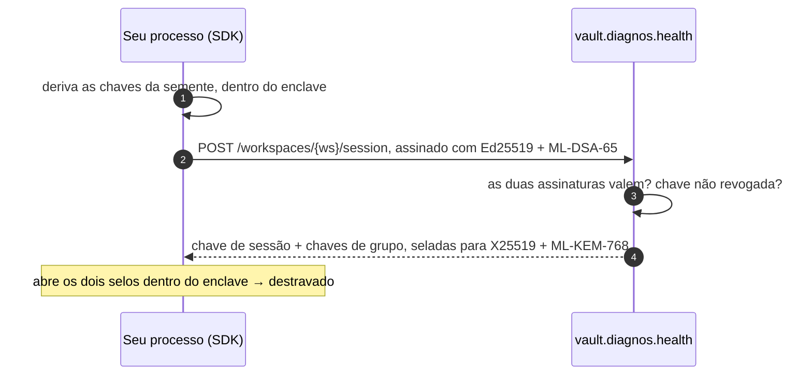

# Autenticação

[English](authentication.md) · **Português (Brasil)**

Um processo do diagnos precisa de uma coisa antes de ler um único registro: um **token de conta de serviço**. O token
é ao mesmo tempo a identidade — qual conta de serviço, qual workspace — e a chave que abre as chaves do cofre para os
grupos que o token recebeu. Não há etapa de pareamento nem código de aprovação: um processo que tem o token assina uma
requisição, e a sessão está aberta.

## O token de conta de serviço

Um admin do workspace cria uma conta de serviço no app web do diagnos (*Configurações → Contas de serviço*), escolhendo
as permissões e os grupos de segurança que ela pode ler. O token nasce no navegador do admin, que já está destravado:
ele sorteia 32 bytes aleatórios (a *semente*), deriva deles as chaves públicas do token e sela as chaves dos grupos
escolhidos para essas chaves públicas. O cofre recebe só as chaves públicas e as chaves de grupo seladas — nunca a
semente. O token aparece **uma vez**, como uma linha de cerca de 100 caracteres:

```text
dgn_sk1_<key id, semente, workspace e um checksum, em base64url>
```

O prefixo `dgn_sk1_` o torna reconhecível por scanners de segredo (gitleaks, secret scanning do GitHub) e pela CLI. Os
últimos quatro bytes são um CRC-32: um token cortado ou colado errado é pego **antes de qualquer chamada de rede**, com
uma mensagem que diz exatamente isso. O SDK move a semente para o enclave em Rust no momento em que lê a linha; tudo o
que o token faz é derivado da semente ali, e nem a semente nem nenhuma chave privada sai de lá.

| Exposto como | Significado |
|---|---|
| `vault.workspace_id` | o workspace para o qual toda URL é montada |
| `vault.identity` | `svc_<hex>@<workspace_id>.diagnos.health` |
| `vault.key_id` | `svc_<hex>` — a chave que um admin gira ou revoga |
| `vault.token_kind` | `"hybrid"` (`"legacy_apikey"` para o token obsoleto) |
| `vault.token_source` | de onde o token foi lido — `DIAGNOS_TOKEN`, `keyring`, `OpenBao …` |
| `vault.account_id`, `vault.name`, `vault.email` | `None`: a identidade é a própria chave |

```python
from diagnos import Diagnos

vault = Diagnos()  # acha o token e confere o CRC; nada toca a rede ainda
print(vault.workspace_id, vault.key_id, vault.token_kind, vault.token_source)
print(repr(vault))  # só a identidade — o token nunca aparece
```

> [!WARNING]
> Quem tem o token tem o acesso que ele dá, como uma chave privada: ele abre os grupos que recebeu, sem ninguém para
> aprovar. Por isso ele aparece uma vez, a CLI o guarda no chaveiro do sistema ou no OpenBao e nunca num arquivo de
> texto, uma revogação vale na próxima requisição, e o escopo dele deve ser o menor que funciona. O SDK nunca o
> registra em log: `repr` e `str` mostram só a identidade, um token se recusa a ser serializado com pickle, e um erro
> nunca carrega o texto dele.

## Por que duas assinaturas — clássica e pós-quântica

Toda requisição é assinada duas vezes, e o cofre só a aceita quando **as duas** assinaturas são válidas: uma com
Ed25519, o algoritmo clássico em uso há anos, e outra com ML-DSA-65 (FIPS 204), um algoritmo pós-quântico. As chaves do
cofre são seladas do mesmo jeito, para X25519 e ML-KEM-768 (FIPS 203) juntos, e um selo só abre com os dois segredos.

O motivo é simples: os algoritmos clássicos são bem testados, mas um computador quântico grande o bastante os
quebraria; os pós-quânticos resistem a esse computador, mas são novos. Usar os dois significa que um atacante precisa
quebrar **os dois** — um defeito achado em um deles, ou um computador quântico no futuro, não basta. Um dado gravado
hoje continua protegido amanhã. O custo é uma assinatura maior (3.373 bytes por requisição), que você nunca manipula.

A assinatura segue o [HTTP Message Signatures, RFC 9421](https://www.rfc-editor.org/rfc/rfc9421): não existe segredo
bearer para roubar do tráfego, e cada requisição leva um horário e um nonce novos, então uma requisição copiada é
recusada.

## Onde o token mora

O SDK procura nesta ordem, e o primeiro encontrado vence:

| Onde | Quando |
|---|---|
| `Diagnos(token=…)` / `--token` | um processo que fala como duas contas de serviço |
| `DIAGNOS_TOKEN` no ambiente | CI e containers efêmeros, onde um segredo chega como variável |
| o chaveiro do sistema | uma estação de trabalho: o `diagnos login` o guarda ali — Keychain do macOS, Credential Locker do Windows, Secret Service ou KWallet |
| OpenBao, `secret/diagnos/token` | um servidor: o `diagnos login --store openbao` o guarda ali, e o `diagnos-api` o lê na subida |

**Recomendado:** o chaveiro numa estação de trabalho e o OpenBao num servidor. O `diagnos login` escolhe o primeiro
lugar seguro: o chaveiro do sistema quando há um que cifra em repouso (um backend de chaveiro em texto puro ou "null"
não conta), senão o OpenBao quando o `OPENBAO_ADDR` está configurado, senão recusa e explica as duas opções. Ele
**nunca** grava o token num arquivo de texto. O `DIAGNOS_TOKEN` fica para CI e containers de vida curta; quando a CLI
percebe que o token veio do ambiente num terminal interativo, ela avisa uma vez.

O mesmo está disponível em Python, para um instalador ou um script de provisionamento:

```python no-run
from diagnos import Settings, forget_token, save_token

where = save_token(token_text, settings=Settings.without_token())  # "keyring (…)" ou "OpenBao …"
removed = forget_token(settings=Settings.without_token())  # de onde foi removido
```

`Diagnos(settings=Settings(token=…))` o recebe sem ambiente nenhum — veja [Configuração](configuration.pt-BR.md).

## Abrindo uma sessão



1. O SDK deriva os quatro pares de chaves do token a partir da semente (HKDF-SHA-256): Ed25519 e ML-DSA-65 para
   assinar, X25519 e ML-KEM-768 para abrir selos.
2. Ele manda um `POST …/session` assinado, sem corpo. O cofre confere as duas assinaturas e se a chave ainda vale.
3. A resposta traz a chave de sessão e as chaves dos grupos do token, cada uma selada para as chaves públicas do
   token. O enclave as abre; nada é gravado em disco.

Você raramente faz isso à mão: o primeiro toque em `vault.patients`, `vault.exams` ou `vault.drives` abre a sessão, e
`with Diagnos() as vault:` a abre na entrada. Se o cofre perde a sessão (um reinício, uma expiração), o SDK abre outra
e repete a chamada uma vez — sem pessoa, sem prompt. O `whoami()` abre uma sessão e informa o que ela recebeu:

```python
with Diagnos() as vault:
    me = vault.whoami()
    print(me.identity, me.security_groups, me.session_expires_at)
```

## Quais grupos um processo recebe

O admin decide ao criar o token: só os grupos escolhidos ali são selados para ele, e `vault.security_groups` os lista
depois que a sessão abre. Tocar dados de qualquer outro grupo lança `GroupKeyUnavailable` — uma lacuna de permissão,
não uma falha de criptografia — e linhas de listagem desses grupos voltam com `summary=None` em vez de derrubar a
página:

```python
from diagnos import Diagnos, GroupKeyUnavailable

with Diagnos() as vault:
    print("concedidos:", vault.security_groups)
    try:
        vault.patients.create({"legal_name": "Maria Silva", "display_name": "Maria"}, security_group="sg_cardiology")
    except GroupKeyUnavailable as error:
        print("não concedido:", error)
```

A correção é um token novo que inclua o grupo: ampliar o escopo é criar um token.

## Girando e revogando

- **Gire** criando uma chave nova na mesma conta de serviço, com selos novos: as duas valem até a antiga ser revogada,
  então não há janela sem acesso. Guarde o token novo (`diagnos login` de novo, ou atualize o segredo), reinicie, e
  então revogue a chave antiga.
- **Revogue** no app web. A próxima requisição assinada com essa chave falha com `CredentialRevokedError`, e uma
  sessão que ela abriu cai no próximo uso (veja [Erros](errors.pt-BR.md#falhas-de-credencial)). Os selos de uma chave
  revogada são apagados.

## O token legado `apikey-`

> [!IMPORTANT]
> O `DIAGNOS_API_TOKEN` (um `apikey-` seguido de um JWT) está **obsoleto e para de funcionar em 2027-04-15**. Até lá o
> SDK ainda o aceita, emite um `LegacyTokenWarning` apontando para a sua própria linha e registra um aviso por
> processo. O [MIGRATING.pt-BR.md](../../MIGRATING.pt-BR.md#do-token-apikey--para-o-token-de-conta-de-serviço-020) o
> troca por um token.

O token legado não tem chave própria: o SDK lê quatro claims dele sem verificar a assinatura e o manda como bearer em
toda requisição. Com ele `vault.account_id`, `vault.name` e `vault.key_id` vêm dessas claims, `vault.identity` é
`None` e `vault.token_kind` é `"legacy_apikey"`. Ele pode ser entregue como `DIAGNOS_API_TOKEN`,
`Diagnos(token="apikey-…")` ou `Settings(api_token=…)`. Tudo que está no ambiente vence qualquer cofre, então o que um
shell exporta é sempre o que roda.

Ele também mantém o jeito antigo de obter chaves, o **enrollment**: o processo gera um par X25519 + ML-KEM-768 na RAM,
registra a metade pública e mostra um link e um código de 6 dígitos; um admin do workspace abre o link, confere a
máquina que pede, digita o código e escolhe os grupos. O `unlock()` espera a resposta e lança `EnrollmentDeniedError`
ou `EnrollmentExpiredError` quando ela não vem. O link e o código vão para a `stderr`, ou para o seu callback
`on_prompt`:

```python no-run
from diagnos import Diagnos, EnrollmentPrompt


def notify(prompt: EnrollmentPrompt) -> None:
    # EnrollmentPrompt: enrollment_id, approval_url, code, expires_at (segundos Unix)
    print(f"Aprove {prompt.approval_url} com o código {prompt.code} antes de {prompt.expires_at}")


vault = Diagnos(on_prompt=notify)  # com DIAGNOS_API_TOKEN definida
vault.unlock()
```

Na CLI, o `diagnos session start` roda esse enrollment uma vez e mantém a sessão num agente em segundo plano, para os
próximos comandos não pedirem de novo — veja o [guia da CLI](cli.pt-BR.md#o-token-legado-no-terminal).

## Boas práticas

- **Uma conta de serviço por integração**, e uma por réplica se ela roda como vários processos: um admin consegue
  então revogar exatamente uma delas.
- **Os menos grupos que funcionam.** Um token decifra tudo nos grupos que tem.
- **O chaveiro numa estação de trabalho, o OpenBao num servidor**, o `DIAGNOS_TOKEN` só para CI e containers
  efêmeros, direto de um cofre de segredos. Nunca num repositório, num arquivo `.env` ou numa linha de log.
- **Gire com sobreposição.** Crie a chave nova, faça o deploy, e então revogue a antiga.
