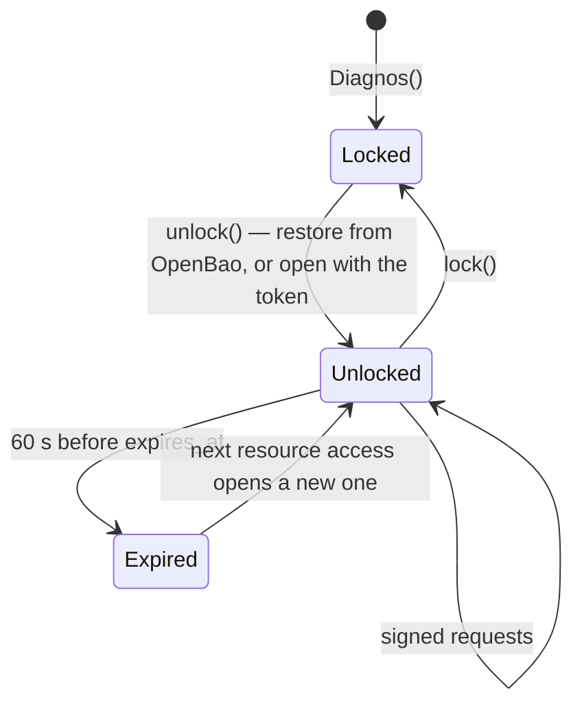
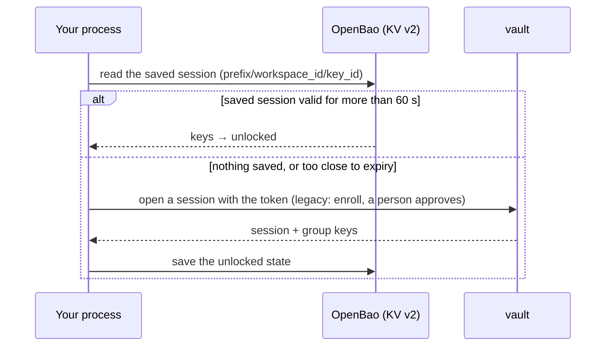

# Sessions

**English** · [Português (Brasil)](sessions.pt-BR.md)

A session is what the [service account token](authentication.md#opening-a-session) opens in your process: a session
id, the two keys that sign and protect its requests, and the key of every security group in the token's scope — all of
it in locked memory, valid until the vault's `expires_at`. This page is about its life: when it starts, how it ends,
and what OpenBao adds for a server.

## The lifecycle



- **`Diagnos()`** only finds and parses the token. It makes no request to the vault.
- **`unlock()`** restores a saved session from OpenBao when auto-unseal is on and it is still valid, and otherwise opens one
  with a single signed `POST …/session` (the legacy `apikey-` token enrolls instead, and waits for a person). It is
  idempotent, and you rarely call it: `with Diagnos() as vault:` unlocks on entry, and the first touch of
  `vault.patients`, `vault.exams` or `vault.drives` unlocks lazily.
- **Unlocking hardens the process** first — core dumps off, debugger attach denied — because this is the moment it
  starts holding clinical keys. [The enclave](../../apps/sdk/native/README.md) lists exactly what that does.

```python
from diagnos import Diagnos

vault = Diagnos()
print(vault.security_groups)  # [] — nothing unlocked yet
vault.patients.list()  # unlocks on first use
print(vault.security_groups)  # the granted groups
```

## Closing is not locking

Leaving a `with` block — or calling `close()` — closes the HTTP connections and nothing else. The session stays
valid, so a worker with OpenBao auto-unseal that restarts a minute later restores the very same session. Ending a
session is a separate, explicit act:

```python
from diagnos import Diagnos

with Diagnos() as vault:
    vault.patients.list()
    vault.lock()  # ends the session on the vault, deletes the OpenBao copy, wipes every key in this process
```

`lock()` is best-effort towards the vault — a network error or an already-expired session does not stop it — and
unconditional locally: every key is zeroed whether or not the vault answered.

## Expiry

The vault sets `expires_at` when it opens the session. The SDK treats a session as over **60 seconds early**, so no
request starts signing with a session that could expire mid-flight. What happens next depends on how you reach the
vault:

| You call | With an expired or lost session |
|---|---|
| `vault.patients` / `vault.exams` / `vault.drives` | unlocks again — restores from OpenBao, or opens a new session with the token |
| `unlock()` | the same |
| any call the vault answers with `SessionNotFound` (it restarted, or dropped the session) | the SDK opens a new session and retries the call once (the legacy token: the error reaches you) |
| a signed request with no live session at all | `SessionExpiredError` |

> [!NOTE]
> With the service account token none of this needs a person: a long-running process just opens a new session. The
> legacy `apikey-` token is the exception — it **prompts again** when its session expires and blocks until someone
> approves, which is what [auto-unseal](#auto-unseal-with-openbao) was made for.

## One process, one session

A session is never written to disk (unless you opt into OpenBao) and never shared between processes:

- **Every process opens its own session.** Two workers are two sessions, from the same token. Each CLI command opens
  its own, too; only the legacy token keeps one process alive on purpose — its
  [session agent](cli.md#the-legacy-token-in-the-terminal) runs the commands that follow inside the process that holds
  the session, so the keys still never cross a process boundary.
- **Threads share one `Diagnos`.** Unlock it once before handing it to worker threads — the REST API does exactly
  that at startup — so two threads never race to open a session.
- **A `fork()` child starts empty.** Key pages are wiped in a forked child, and using one raises. With `gunicorn`,
  `multiprocessing` or Celery prefork, build the `Diagnos` inside each worker, after the fork.

## Auto-unseal with OpenBao

With auto-unseal on, the SDK saves its unlocked state in [OpenBao](https://openbao.org/) right after it opens a session
and restores it on the next start, until the saved session itself expires. With the legacy `apikey-` token that is
what spares a person approving every restart of a pod or a cron job, so it is **on by default** whenever OpenBao is
configured. With the service account token it would save only one signed request per restart — a restart never needs
a person — at the price of group keys that outlive a revocation of the token, so it is **off by default**.



### Turning it on

```sh
pip install "diagnos[openbao]"
export OPENBAO_ADDR="https://openbao.internal:8200"
export OPENBAO_TOKEN="…"            # or OPENBAO_TOKEN_FILE=/run/secrets/openbao-token
```

By default auto-unseal is on for the legacy token when `OPENBAO_ADDR` is set, and off for a service account token —
even though the same `OPENBAO_ADDR` is how a server reads the token itself from OpenBao. `auto_unseal=` overrides the
default for one client (`Diagnos(auto_unseal=True)` turns it on with the token, knowingly), and the CLI's
`session start --auto-unseal/--no-auto-unseal` does the same for one invocation:

```python
from diagnos import Diagnos

vault = Diagnos()  # the token: the session is never saved; the legacy token: saved when OPENBAO_ADDR is set
local_only = Diagnos(auto_unseal=False)  # never saves or restores, whatever the token
```

`OPENBAO_MOUNT`, `OPENBAO_PATH_PREFIX` and `OPENBAO_NAMESPACE` are in [Configuration](configuration.md#openbao).

### The trade-off

> [!WARNING]
> Auto-unseal moves your group keys from "only ever in this process's locked memory" to "also in OpenBao's storage,
> at `<OPENBAO_PATH_PREFIX>/<workspace_id>/<key_id>`". **Whoever can read that one path can decrypt exactly what this
> process can**, and keeps the group keys even after the token is revoked — a revocation stops new sessions, not
> keys already copied. With the service account token the gain is one request per restart, which is why it is off by
> default; turn it on with `auto_unseal=True` only when that request matters more than an immediate revocation.

| | Without OpenBao | With OpenBao |
|---|---|---|
| where group keys live | this process's locked RAM | that, plus OpenBao's encrypted KV |
| a restart needs | one signed request (the legacy token: a person to approve) | nothing, until the saved session expires |
| revoking the token | cuts the process off at its next request | the saved group keys stay readable in OpenBao |
| a stolen OpenBao token with read on the path | — | decrypts what this process can |
| keys as Python objects | never | for milliseconds, while saving and restoring |

The last row is the one place keys leave the memory enclave: to be written as JSON, they are revealed into buffers
that are zeroed as soon as the request is built. [The enclave](../../apps/sdk/native/README.md#what-is-not) states
the window precisely.

### Scoping the OpenBao token

Give the process a token that can reach its own paths and nothing else. This is the policy the Compose and Kubernetes
bootstraps write (`apps/api/deploy/compose/openbao/policy.hcl`), with the workspace and key ids filled in:

```hcl
path "secret/data/diagnos/<workspace_id>/<key_id>" {
  capabilities = ["create", "update", "read", "delete"]
}
path "secret/metadata/diagnos/<workspace_id>/<key_id>" {
  capabilities = ["create", "update", "read", "delete"]
}
path "secret/data/diagnos/token" {
  capabilities = ["read"]
}
```

The first two rules matter only when auto-unseal is on (the legacy token, or `auto_unseal=True`); `metadata/` is there
because `lock()` deletes every saved version, not only the latest. The last rule lets the process
*read* the token and nothing more: storing or rotating it takes the separate writer token of
`token-writer-policy.hcl`, which `diagnos login --store openbao` uses. `diagnos whoami` prints the two ids.

### What is saved, and when it is used

- **Saved** right after every session is opened, overwriting the previous one. The exact JSON is in
  [PROTOCOL.md §11](../PROTOCOL.md#11-openbao-auto-unseal).
- **Restored** by `unlock()` only while the saved session has more than 60 seconds left; otherwise the process
  opens a new session and saves it.
- **Deleted** by `lock()` — every version of it.

### Choosing

| You run | Use |
|---|---|
| a script on your laptop | `diagnos login` once: the token in the system keyring, a session per run |
| the CLI at your terminal | the same; every command opens its own session, with no prompt |
| CI, or an ephemeral container | `DIAGNOS_TOKEN` from the secret store |
| the CLI from cron, a long-running worker or pod | the token in OpenBao, read with a token scoped to read it; one service account per replica |
| the REST API | OpenBao — the [deploy manifests](../../apps/api/deploy/README.md) ship it, with KMS auto-unseal for OpenBao itself |
