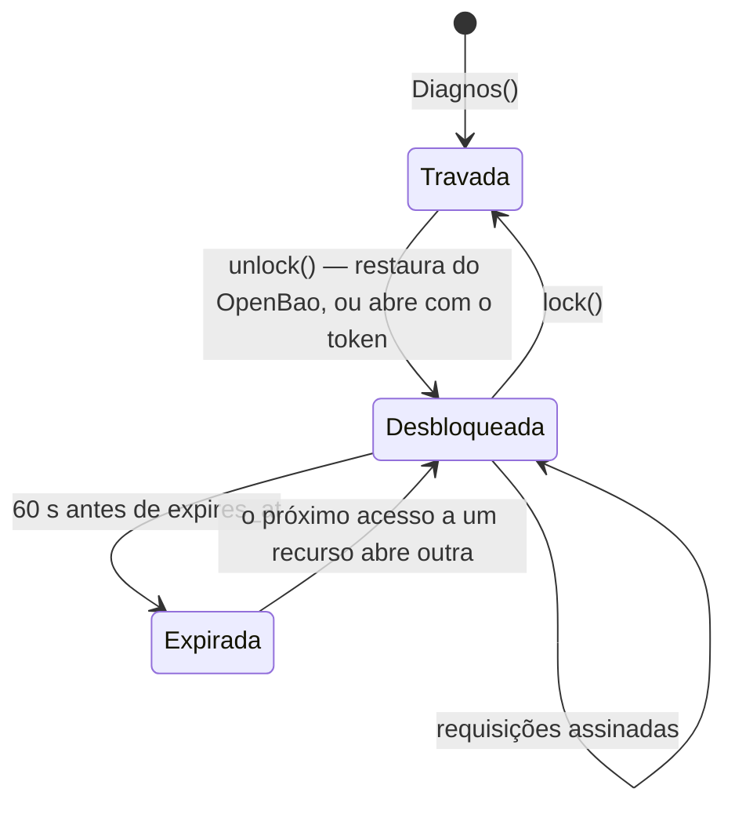
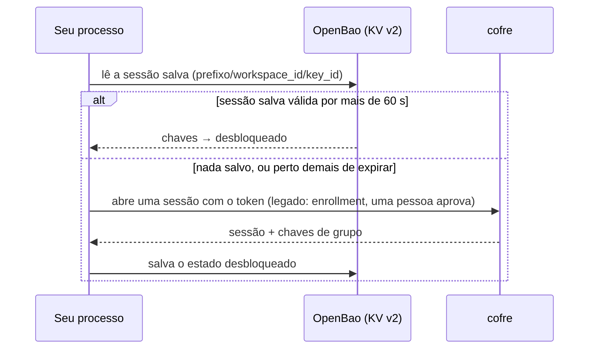

# Sessões

[English](sessions.md) · **Português (Brasil)**

Uma sessão é o que o [token de conta de serviço](authentication.pt-BR.md#abrindo-uma-sessão) abre no seu processo:
um id de sessão, as duas chaves que assinam e protegem as requisições dela e a chave de todo security group do escopo
do token — tudo em memória travada, válido até o `expires_at` do cofre. Esta página é sobre a vida dela: quando
começa, como termina e o que o OpenBao acrescenta para um servidor.

## O ciclo de vida



- **`Diagnos()`** só acha e lê o token. Não faz requisição ao cofre.
- **`unlock()`** restaura uma sessão salva do OpenBao quando o auto-unseal está ligado e ela ainda vale, e senão abre uma com
  um único `POST …/session` assinado (o token legado `apikey-` faz enrollment no lugar, e espera uma pessoa). É
  idempotente, e você raramente o chama: `with Diagnos() as vault:` desbloqueia na entrada, e o primeiro toque em
  `vault.patients`, `vault.exams` ou `vault.drives` desbloqueia de forma preguiçosa.
- **Desbloquear endurece o processo** antes — core dumps desligados, anexar um debugger negado — porque este é o
  momento em que ele começa a guardar chaves clínicas. [O enclave](../../apps/sdk/native/README.pt-BR.md) lista
  exatamente o que isso faz.

```python
from diagnos import Diagnos

vault = Diagnos()
print(vault.security_groups)  # [] — nada desbloqueado ainda
vault.patients.list()  # desbloqueia no primeiro uso
print(vault.security_groups)  # os grupos concedidos
```

## Fechar não é travar

Sair de um bloco `with` — ou chamar `close()` — fecha as conexões HTTP e nada mais. A sessão continua válida, então
um worker com auto-unseal no OpenBao que reinicia um minuto depois restaura a mesmíssima sessão. Encerrar uma sessão é
um ato à parte, explícito:

```python
from diagnos import Diagnos

with Diagnos() as vault:
    vault.patients.list()
    vault.lock()  # encerra a sessão no cofre, apaga a cópia no OpenBao, zera toda chave neste processo
```

`lock()` é best-effort em relação ao cofre — um erro de rede ou uma sessão já expirada não o impedem — e
incondicional localmente: toda chave é zerada tenha o cofre respondido ou não.

## Expiração

O cofre define o `expires_at` quando abre a sessão. O SDK considera uma sessão encerrada **60 segundos antes**, para
nenhuma requisição começar a assinar com uma sessão que poderia expirar no meio do caminho. O que acontece depois
depende de como você chega ao cofre:

| Você chama | Com uma sessão expirada ou perdida |
|---|---|
| `vault.patients` / `vault.exams` / `vault.drives` | desbloqueia de novo — restaura do OpenBao, ou abre uma sessão nova com o token |
| `unlock()` | o mesmo |
| qualquer chamada que o cofre responde com `SessionNotFound` (ele reiniciou, ou perdeu a sessão) | o SDK abre uma sessão nova e repete a chamada uma vez (o token legado: o erro chega a você) |
| uma requisição assinada sem sessão viva nenhuma | `SessionExpiredError` |

> [!NOTE]
> Com o token de conta de serviço nada disso precisa de uma pessoa: um processo de longa duração só abre uma sessão
> nova. O token legado `apikey-` é a exceção — ele **mostra o prompt de novo** quando a sessão expira e bloqueia até
> alguém aprovar, que é para o que o [auto-unseal](#auto-unseal-com-openbao) foi feito.

## Um processo, uma sessão

Uma sessão nunca é gravada em disco (a menos que você opte pelo OpenBao) e nunca é compartilhada entre processos:

- **Todo processo abre a própria sessão.** Dois workers são duas sessões, do mesmo token. Cada comando da CLI abre a
  própria também; só o token legado mantém um processo vivo de propósito — o
  [agente de sessão](cli.pt-BR.md#o-token-legado-no-terminal) dele roda os comandos seguintes dentro do processo que
  guarda a sessão, então as chaves continuam sem cruzar a fronteira de um processo.
- **Threads compartilham um `Diagnos`.** Desbloqueie-o uma vez antes de entregá-lo às threads — a API REST faz
  exatamente isso na subida — para duas threads nunca disputarem a abertura de uma sessão.
- **Um filho de `fork()` começa vazio.** As páginas de chave são zeradas num filho de fork, e usar uma lança erro.
  Com `gunicorn`, `multiprocessing` ou Celery em prefork, construa o `Diagnos` dentro de cada worker, depois do fork.

## Auto-unseal com OpenBao

Com o auto-unseal ligado, o SDK salva o estado desbloqueado no [OpenBao](https://openbao.org/) logo depois de abrir
uma sessão e o restaura na subida seguinte, até a própria sessão salva expirar. Com o token legado `apikey-` é isso
que poupa uma pessoa de aprovar todo reinício de um pod ou de um cron, então ele vem **ligado por padrão** sempre que
o OpenBao está configurado. Com o token de conta de serviço ele pouparia só uma requisição assinada por reinício — um
reinício nunca precisa de pessoa — ao preço de chaves de grupo que sobrevivem à revogação do token, então ele vem
**desligado por padrão**.



### Ligando

```sh
pip install "diagnos[openbao]"
export OPENBAO_ADDR="https://openbao.internal:8200"
export OPENBAO_TOKEN="…"            # ou OPENBAO_TOKEN_FILE=/run/secrets/openbao-token
```

Por padrão o auto-unseal está ligado para o token legado quando `OPENBAO_ADDR` está definida, e desligado para um
token de conta de serviço — mesmo que essa mesma `OPENBAO_ADDR` seja como um servidor lê o próprio token do OpenBao.
`auto_unseal=` sobrescreve o padrão para um cliente (`Diagnos(auto_unseal=True)` o liga com o token, sabendo o que
troca), e o `session start --auto-unseal/--no-auto-unseal` da CLI faz o mesmo para uma invocação:

```python
from diagnos import Diagnos

vault = Diagnos()  # o token: a sessão nunca é salva; o token legado: salva quando OPENBAO_ADDR está definida
local_only = Diagnos(auto_unseal=False)  # nunca salva nem restaura, qualquer que seja o token
```

`OPENBAO_MOUNT`, `OPENBAO_PATH_PREFIX` e `OPENBAO_NAMESPACE` estão em [Configuração](configuration.pt-BR.md#openbao).

### A troca

> [!WARNING]
> O auto-unseal leva as suas chaves de grupo de "só na memória travada deste processo" para "também no armazenamento
> do OpenBao, em `<OPENBAO_PATH_PREFIX>/<workspace_id>/<key_id>`". **Quem consegue ler esse único path decifra
> exatamente o que este processo decifra**, e fica com as chaves de grupo mesmo depois de o token ser revogado — uma
> revogação impede sessões novas, não chaves já copiadas. Com o token de conta de serviço o ganho é uma requisição por
> reinício, e por isso ele vem desligado; ligue com `auto_unseal=True` só quando essa requisição importar mais que uma
> revogação imediata.

| | Sem OpenBao | Com OpenBao |
|---|---|---|
| onde as chaves de grupo moram | a RAM travada deste processo | isso, mais o KV cifrado do OpenBao |
| um reinício precisa de | uma requisição assinada (o token legado: uma pessoa para aprovar) | nada, até a sessão salva expirar |
| revogar o token | corta o processo na próxima requisição | as chaves de grupo salvas continuam legíveis no OpenBao |
| um token do OpenBao roubado com leitura no path | — | decifra o que este processo decifra |
| chaves como objetos Python | nunca | por milissegundos, ao salvar e restaurar |

A última linha é o único lugar em que chaves saem do enclave de memória: para serem gravadas como JSON, elas são
reveladas em buffers que são zerados assim que a requisição é montada. [O
enclave](../../apps/sdk/native/README.pt-BR.md#o-que-não-é) descreve a janela com precisão.

### Restringindo o token do OpenBao

Dê ao processo um token que alcance os próprios paths e nada mais. Esta é a política que os bootstraps do Compose e
do Kubernetes gravam (`apps/api/deploy/compose/openbao/policy.hcl`), com os ids de workspace e de chave preenchidos:

```hcl
path "secret/data/diagnos/<workspace_id>/<key_id>" {
  capabilities = ["create", "update", "read", "delete"]
}
path "secret/metadata/diagnos/<workspace_id>/<key_id>" {
  capabilities = ["create", "update", "read", "delete"]
}
path "secret/data/diagnos/token" {
  capabilities = ["read"]
}
```

As duas primeiras regras só importam com o auto-unseal ligado (o token legado, ou `auto_unseal=True`); o `metadata/`
está lá porque `lock()` apaga toda versão salva, não só a última. A última regra deixa o processo *ler*
o token e nada mais: guardar ou girar exige o token de escrita separado de `token-writer-policy.hcl`, que o
`diagnos login --store openbao` usa. O `diagnos whoami` imprime os dois ids.

### O que é salvo, e quando é usado

- **Salvo** logo depois de toda sessão aberta, sobrescrevendo a anterior. O JSON exato está no
  [PROTOCOL.pt-BR.md §11](../PROTOCOL.pt-BR.md#11-auto-unseal-com-openbao).
- **Restaurado** pelo `unlock()` só enquanto a sessão salva tem mais de 60 segundos pela frente; senão o processo
  abre uma sessão nova e a salva.
- **Apagado** pelo `lock()` — toda versão dele.

### Escolhendo

| Você roda | Use |
|---|---|
| um script no seu notebook | `diagnos login` uma vez: o token no chaveiro do sistema, uma sessão por execução |
| a CLI no seu terminal | o mesmo; todo comando abre a própria sessão, sem prompt |
| CI, ou um container efêmero | `DIAGNOS_TOKEN` vindo do cofre de segredos |
| a CLI a partir do cron, um worker ou pod de longa duração | o token no OpenBao, lido com um token restrito a lê-lo; uma service account por réplica |
| a API REST | OpenBao — os [manifestos de deploy](../../apps/api/deploy/README.pt-BR.md) já o trazem, com auto-unseal por KMS para o próprio OpenBao |
